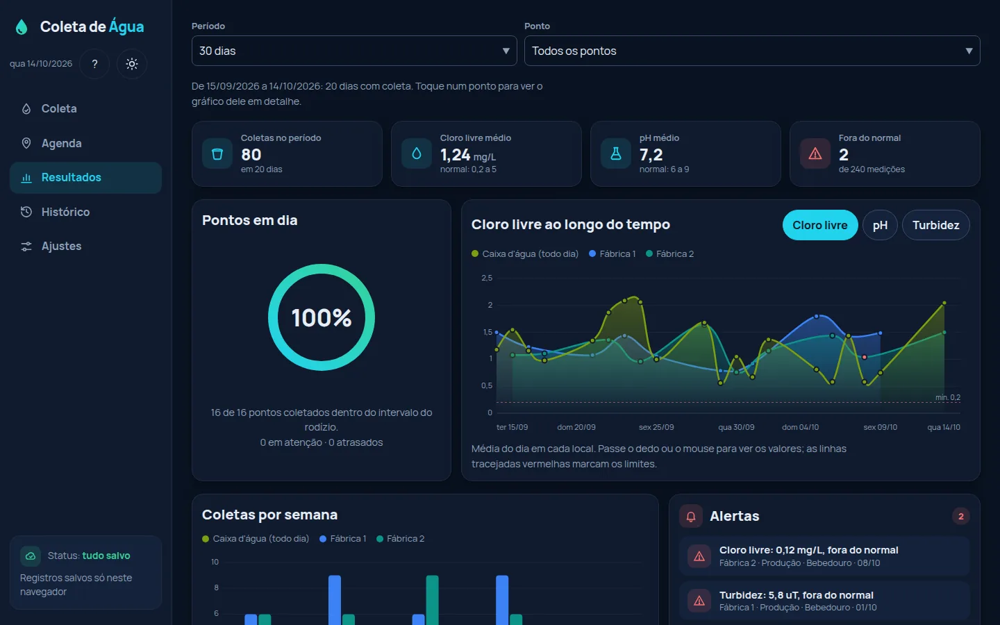
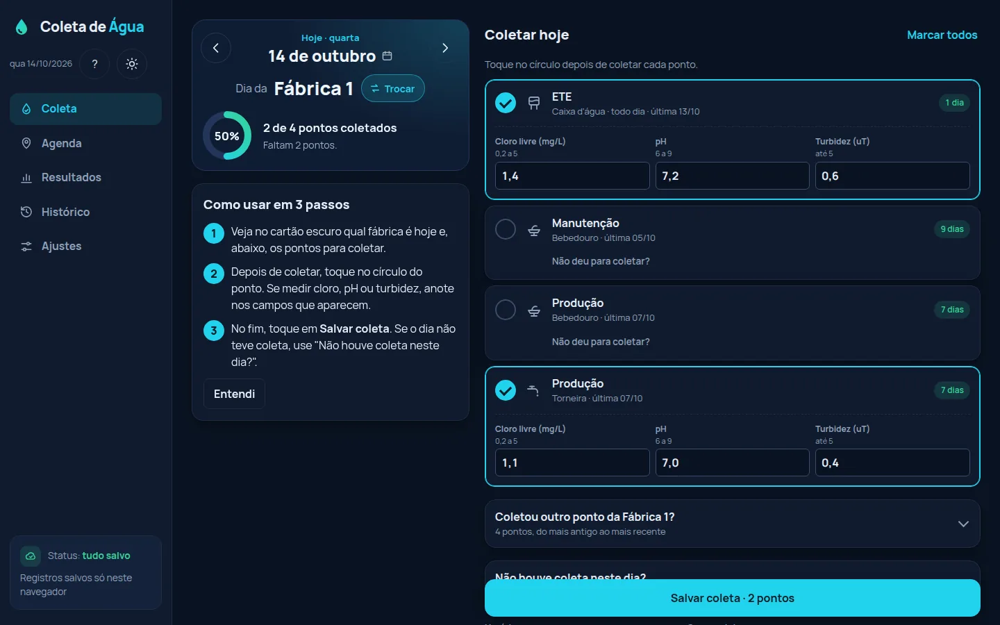
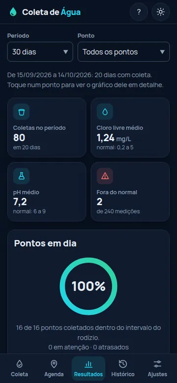

# Coleta de Água



**Site:** https://coleta-agua.onrender.com

Site para planejar e registrar a coleta diária de amostras de água potável em duas fábricas. Nasceu da necessidade de um amigo estagiário, que coleta amostras todo dia, alternando entre a Fábrica 1 e a Fábrica 2 e priorizando os pontos que estão há mais tempo sem coleta. Ele trouxe as ideias e pediu um site para organizar essa rotina.

## Como funciona

1. **Coleta do dia:** o site indica a fábrica do dia e os pontos do rodízio (a caixa d'água, a torneira e os bebedouros parados há mais tempo).
2. **Registro:** ao marcar um ponto, aparecem os campos de cloro livre, pH e turbidez. Valores fora da faixa da Portaria GM/MS 888/2021 ficam em vermelho.
3. **Acompanhamento:** a agenda prevê os próximos dias úteis, e o painel mostra indicadores, gráficos e alertas.



## Recursos

- Rodízio automático entre as duas fábricas, com regras por tipo de ponto (torneira e bebedouro)
- Agenda dos próximos dias úteis; dias sem coleta (feriado, falta, fábrica parada) não contam no rodízio
- Registro de cloro livre, pH e turbidez, com alerta de valores fora do normal
- Painel com indicadores, gráficos por período e por ponto e lista de alertas
- Histórico dos dias registrados, com "Copiar resumo" e planilha por período
- Login com conta própria: cada conta guarda as próprias coletas no servidor e vê tudo em qualquer aparelho
- "Esqueci minha senha": o link para criar uma senha nova chega por e-mail
- Modo visitante: usa o site sem cadastro, com os registros só no aparelho, e depois envia tudo para uma conta nova
- Tema claro e escuro e layout para celular, com barra de navegação inferior
- Cópia de segurança: baixar e restaurar os dados



Os prints usam dados de exemplo. A [política de privacidade](https://coleta-agua.onrender.com/privacidade.html) explica quais dados são guardados.

## Tecnologias

- **Site:** HTML, CSS e JavaScript puros, sem frameworks
- **API:** Node.js com Express 5, Prisma e PostgreSQL (Neon)
- **Login:** JWT e bcrypt; e-mail de recuperação de senha pela API do Brevo
- **Hospedagem:** Render (site estático e API)

## Estrutura

```
index.html    site (estilos e scripts embutidos)
privacidade.html  política de privacidade
backend/      API: rotas, schema do Prisma e migrations (veja backend/README.md)
render.yaml   serviços no Render: site estático e API
docs/         imagens deste README
```

## Rodar localmente

Para testar só o site, sem servidor, deixe vazia a tag `<meta name="coleta-api" content="">` no `index.html` e sirva a pasta. Nesse modo os dados ficam só no navegador.

```bash
python3 -m http.server 8080
```

Para rodar a API e publicar no Neon e no Render, siga o [backend/README.md](backend/README.md).

## Autor

Hariel Silva Fabrício · [Portfólio](https://hriel123.github.io/Portifolio/) · [GitHub](https://github.com/hriel123)
